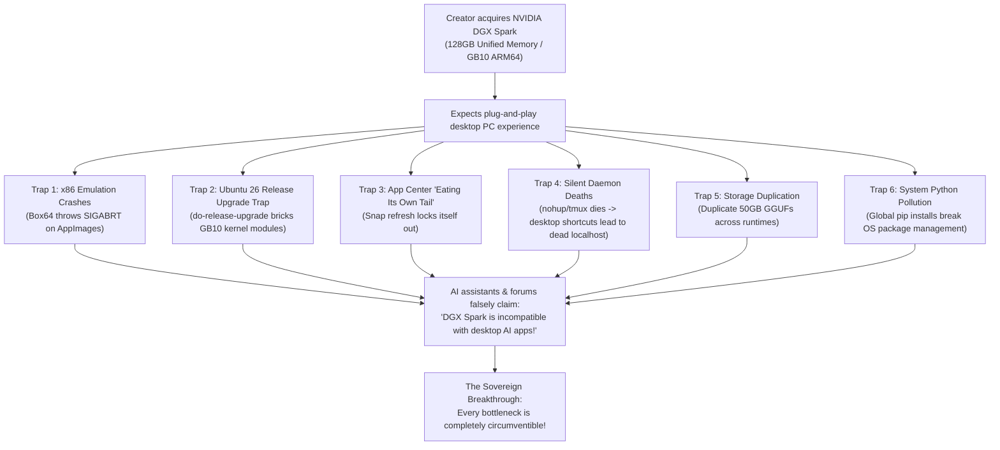
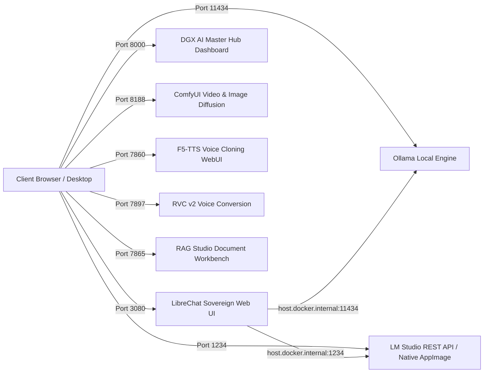

# NVIDIA DGX Spark Agentic Blueprint
## The Sovereign System Administrator Protocol & Field Guide for Grace Blackwell GB10

> **Empowering Creators, Researchers & Engineers to Circumvent the "ARM64 Blackwell Wall"**  
> *A 100% Free, Open-Source, Agent-Agnostic Architecture for Managing, Hardening, and Running SOTA Generative AI on the NVIDIA DGX Spark.*

---

## 1. The Origin Story: The Creator Bottleneck Trap

Across the global AI creator community, early adopters invested in the **NVIDIA DGX Spark** (Grace Blackwell GB10, 128GB Unified Memory, ARM64) anticipating a personal supercomputer. Instead, many creators hit an unexpected wall of friction, confusion, and broken software:



### The 6 Classic Traps & Misconceptions:
1. **The "ARM64 / x86 Translation Trap":**  
   Creators attempted to run standard Linux AppImages (e.g. LM Studio, custom Electron apps). When run via translation layers (`box64`), they instantly threw `SIGABRT` due to unsupported syscalls and missing x86 libraries. Flawed AI assistants declared: *"LM Studio has no GUI on ARM64 and is incompatible with DGX Spark."* **This was completely false.** LM Studio maintains official native ARM64 Linux builds.
2. **The "Ubuntu 26 Release Upgrade Trap":**  
   Ubuntu's default `Prompt=lts` prompted users to upgrade to Ubuntu 26 (`resolute`). When triggered, the distribution upgrade severed NVIDIA's proprietary Grace Blackwell GB10 kernel modules and CUDA 13 drivers, risking an unbootable or headless state.
3. **The "Ouroboros / Eating Your Own Tail Trap":**  
   The Ubuntu App Center (`snap-store`) showed updates for itself in its own GUI. Clicking "Update" caused `snapd` to hang because the app cannot modify its own open files while actively executing.
4. **The "VRAM Ceiling vs. Unified Memory Misconception":**  
   Creators treated the DGX Spark like an overpriced consumer graphics card (RTX 4090/5090). In reality, consumer GPUs are hard-capped by **16GB–24GB VRAM**, making 70B+ LLM inference, Wan 2.1 14B video generation, and full-scale LoRA fine-tuning impossible. The DGX Spark’s **128GB coherent memory pool** eliminates PCIe transfer bottlenecks entirely.
5. **The "Silent Daemon Death & Broken Shortcuts Trap":**  
   Ad-hoc scripts ran background AI servers using `nohup` or `&`. Upon reboot or terminal exit, processes died silently, leaving desktop shortcuts pointing to dead ports and greeting users with browser connection errors.
6. **The "System Python Pollution Trap":**  
   Installing complex generative AI toolkits directly into system Python broke Ubuntu's APT packaging tools (`python3-launchpadlib`, `python3-apt`).

---

## 2. The Philosophy: Why a Master Prompt Beats a Heavy App

Rather than constructing a brittle, bloated software wrapper that requires constant patching as upstream dependencies change, this project takes a **sovereign, agentic approach**:

1. **Agent-Agnostic Design:**  
   Whether you use **Google Antigravity**, **OpenAI Codex**, **OpenClaw**, **Claude Code**, or a local CLI coding agent, you can feed it the [`MASTER_SYSADMIN_PROMPT.md`](./MASTER_SYSADMIN_PROMPT.md).
2. **Instant System Administrator:**  
   The prompt instantly equips the agentic AI with the 9 Core Invariants of the DGX Spark architecture, turning it into a battle-tested system administrator that understands ARM64, GB10 CUDA 13, isolated virtual environments, systemd user daemons, and zero-duplication storage.
3. **Transparent & Reproducible:**  
   Every action is an atomic, verified shell command or configuration change that you can inspect, audit, and understand.
4. **Dynamic Discovery over Hardcoded Assumptions:**  
   The blueprint originates from a verified, physical reference setup on Grace Blackwell GB10 hardware, but the prompt enforces dynamic target-machine discovery (`id -un`, `$HOME`, GPU state, ports) and uses systemd `%h` specifiers so it automatically adapts to any user environment without hardcoded paths.

---

## 3. The DGX Spark Architectural Invariants

| Invariant | Problem Solved | Correct Sovereign Practice |
| :--- | :--- | :--- |
| **1. ARM64 Native Primacy** | Avoids `SIGABRT` crashes from `box64` emulation. | Always deploy native `aarch64` binaries (e.g. native LM Studio ARM64 AppImage & `llmster`). |
| **2. OS Distribution Lock** | Prevents breaking GB10 kernel modules via `do-release-upgrade`. | Set `Prompt=never` in `/etc/update-manager/release-upgrades`. Pin to Ubuntu 24.04 LTS (Noble). |
| **3. Workspace & Venv Isolation** | Prevents global Python collisions and home directory pollution. | Strict folder layout: `~/ai-workspace/{apps,environments,models,scripts}`. Never use system Python. |
| **4. Persistent Systemd Daemons** | Eliminates dead localhost ports from killed `nohup` jobs. | All services run under `~/.config/systemd/user/` with `loginctl enable-linger $USER` active. |
| **5. Zero-Duplication Storage** | Prevents filling NVMe storage with duplicate 50GB checkpoints. | Store master checkpoints in `~/ai-workspace/models/` and symlink via `lms import -l` or Modelfiles. |
| **6. Hardware-Aware Generative Media** | Prevents memory bus thrashing during video diffusion. | Apply the 5 Acceleration Levers: Scaled FP8, Step Distillation LoRA, `--highvram`, native latents. |
| **7. Sovereign Voice & Audio DSP** | Avoids low-quality TTS and robotic prosody. | Zero-shot flow matching (F5-TTS/RVC v2), automated plosive detection, and 8-stage Dolby Broadcast DSP. |
| **8. Container-Host Bridge** | Resolves Docker UIs failing to reach host LLM endpoints. | Bind host AI daemons to `0.0.0.0` or configure `host.docker.internal:host-gateway`. |
| **9. Plain-Text Accessibility** | Prevents users with ADHD or busy workflows from getting locked out. | Place permanent credential files (e.g. `LIBRECHAT_LOGIN.txt`) directly on `~/Desktop/`. |

---

## 4. Workspace Architecture & Virtual Environments

To keep `/home/$USER/` pristine and eliminate package collision risks, all runtimes and repositories strictly follow this layout:

```
/home/$USER/ai-workspace/
├── apps/                          # Sovereign applications & git clones
│   ├── ComfyUI/                   # SOTA image & video diffusion studio (:8188)
│   ├── F5-TTS/                    # Zero-shot voice cloning WebUI (:7860)
│   ├── LibreChat/                 # Multi-model sovereign chat UI (:3080)
│   ├── LM-Studio/                 # Native ARM64 AppImage & launch scripts
│   ├── polyglot-g2p/              # 8-language phonetic trie & broadcast DSP engine
│   └── Retrieval-based-Voice-Conversion-WebUI/ # RVC v2 audio conversion (:7897)
│
├── environments/                  # Fully isolated Python virtual environments
│   ├── comfyui-env/               # PyTorch CUDA 13.0, Diffusers, ComfyUI nodes
│   ├── tts-env/                   # F5-TTS, Faster-Whisper, Praat, Rembg, Real-ESRGAN
│   ├── docling-env/               # Docling, ColPali, PyMuPDF, Pytesseract OCR
│   ├── nemo-env/                  # NVIDIA NeMo, Megatron-Core, PEFT, Transformers
│   └── lingbot-env/               # LingBot-Video MoE 30B backend
│
├── models/                        # Centralized zero-duplication model weights
│   ├── diffusion_models/          # Wan2.1 14B Scaled FP8, FLUX.1 [dev], Hunyuan
│   ├── loras/                     # Lightx2v Step Distillation LoRAs
│   ├── clip/                      # UMT5 XXL, CLIP-L, ViT
│   ├── vae/                       # Wan2.1 VAE, FLUX VAE
│   ├── llm/                       # Master GGUFs (symlinked to LM Studio / Ollama)
│   └── tts/                       # Reference vocal samples & RVC index weights
│
└── scripts/                       # Autonomous management & daemon control CLIs
```

---

## 5. Sovereign Generative Media Stack

### A. High-Speed Video Diffusion (ComfyUI & Wan 2.1 14B)
The DGX Spark's 128GB unified memory pool allows running full-scale **Wan 2.1 14B** locally. By applying the **Five Acceleration Levers**, memory traffic drops by **15×**, generating broadcast-quality 5-second video clips in **~75 seconds**:

1. **Workload Sovereignty:** Park competing LLM or OCR daemons to guarantee an uncontended CUDA context and >60GB free memory.
2. **Scaled FP8 Quantization:** `Wan2_1-T2V-14B_fp8_e4m3fn_scaled_KJ.safetensors` (14GB) cuts per-pass bus traffic by 50% without perceptual degradation.
3. **Step Distillation LoRA:** Lightx2v CFG Step Distillation LoRA (`strength: 1.0`, `cfg: 1.0`) cuts sampling from 30+ passes down to **6–8 steps** and eliminates the negative prompt pass.
4. **Unified Memory Flags:** Launch ComfyUI with `--highvram --reserve-vram 8 --disable-pinned-memory` and `PYTORCH_CUDA_ALLOC_CONF="expandable_segments:True"`.
5. **Native Latent Dimensions:** Generate at native 832×480 @ 81 frames (5s @ 16fps), then decouple spatial 2×/4× upscaling post-diffusion via Real-ESRGAN.

### B. Voice Cloning, Neural TTS & Broadcast Mastering
A complete, cloud-independent neural voice workflow:
* **Zero-Shot Voice Cloning:** F5-TTS flow-matching model on port `7860` with RVC v2 model conversion on port `7897`.
* **Automated Plosive Boundary Conditioning:** Scans raw audio clips for voiceless plosive stop boundaries (`/p/`, `/t/`, `/k/`) between 4.8s–8.0s to ensure zero breath clip artifacts.
* **Dolby Broadcast DSP:** 8-stage post-processing chain (40Hz highpass, gentle de-esser, multi-band dynamics, and ITU-R BS.1770 -14 LUFS loudness normalization).
* **Phonetic Script Restructuring:** Cleans loanwords, converts numbers to spoken natural English, and decomposes complex prose into 8–15 word breath clauses.

### C. Document Intelligence, OCR & Super-Resolution
* **Tesseract 5 LSTM Suite:** Multi-lingual OCR supporting English, Thai (`tesseract-ocr-tha`), and orientation detection (`osd`) at `/usr/share/tesseract-ocr/5/tessdata/`.
* **Multimodal Document RAG:** Docling + ColPali vision embeddings for zero-loss PDF document ingestion and table extraction.
* **AI Super-Resolution:** Real-ESRGAN (`basicsr` PyTorch 2.x patched) for high-fidelity 4× spatial upscaling.
* **Background Removal:** Rembg (BiRefNet / U2Net) for instant clean cutouts.

---

## 6. System Dependencies Checklist

Before running generative stacks, execute the system dependency installer:

```bash
sudo apt-get update && sudo apt-get install -y \
  ffmpeg \
  sox libsox-fmt-all \
  tesseract-ocr tesseract-ocr-eng tesseract-ocr-tha tesseract-ocr-osd libtesseract-dev \
  exiftool imagemagick \
  libfuse2t64 \
  sshpass \
  build-essential cmake python3-dev
```

---

## 7. Quick Start: How to Use This Blueprint

### Step 1: Clone This Repository
```bash
git clone https://github.com/AjarnSpencer/dgx-spark-agentic-blueprint.git ~/ai-workspace/apps/dgx-spark-agentic-blueprint
cd ~/ai-workspace/apps/dgx-spark-agentic-blueprint
```

### Step 2: Feed the Master Prompt to Your AI Agent
Open your agentic assistant (**Google Antigravity**, **Claude Code**, **OpenClaw**, or **Codex**) and paste the complete contents of:  
👉 [`MASTER_SYSADMIN_PROMPT.md`](./MASTER_SYSADMIN_PROMPT.md)

### Step 3: Run Modular Sub-Commands
Command your AI agent using intuitive sub-commands:

* **`/audit`** — Runs a comprehensive telemetry check across the GB10 GPU, 128GB unified memory pool, active listening ports, and enabled systemd user services.
* **`/lock-os`** — Permanently locks Ubuntu against accidental distribution upgrades (`resolute` / Ubuntu 26) to preserve NVIDIA Blackwell drivers.
* **`/setup-workspace-hierarchy`** — Scaffolds canonical `~/ai-workspace/` folders and model asset categories.
* **`/install-system-dependencies`** — Installs required APT packages for media, audio DSP, and OCR.
* **`/install-lmstudio-gui`** — Downloads and configures the official native ARM64 LM Studio AppImage on the desktop.
* **`/enable-llmster`** — Configures the headless `llmster` engine as an enabled systemd user service listening on `0.0.0.0:1234`.
* **`/symlink-models`** — Scans existing GGUF models and links them into LM Studio with zero disk duplication.
* **`/deploy-librechat`** — Deploys the sovereign LibreChat multi-model chat UI with persistent 10-year login sessions and auto-generated desktop login cheat sheets.
* **`/deploy-comfyui-video`** — Deploys ComfyUI with Wan 2.1 14B Scaled FP8, Lightx2v LoRA, and unified memory flags on `:8188`.
* **`/deploy-tts-audio-suite`** — Deploys F5-TTS, RVC v2, and Dolby Broadcast DSP mastering in `tts-env`.
* **`/deploy-ocr-suite`** — Deploys Docling, ColPali, and Tesseract 5 LSTM tools in `docling-env`.

---

## 8. Verified Port Architecture on DGX Spark



| Service | Port | Protocol | Interface Type | Description |
| :--- | :--- | :--- | :--- | :--- |
| **LM Studio (llmster)** | `1234` | HTTP / REST | OpenAI-Compatible API | Headless native ARM64 inference engine on GB10 GPU |
| **LM Studio GUI** | Desktop | AppImage | Native Linux ARM64 Window | Official visual model explorer and chat GUI |
| **LibreChat** | `3080` | HTTP / Web | Web Application (Docker) | Sovereign multi-model chat interface with saved history |
| **Ollama** | `11434` | HTTP / REST | Local Engine | Multi-model background LLM runner |
| **ComfyUI** | `8188` | HTTP / Web | Node-Based WebUI | Local video & image diffusion (Wan 2.1 14B / FLUX.1) |
| **F5-TTS** | `7860` | HTTP / Web | Gradio WebUI | Zero-shot neural voice cloning & speech synthesis |
| **RVC v2** | `7897` | HTTP / Web | Gradio WebUI | Retrieval-based voice conversion and vocal model training |
| **RAG Studio** | `7865` | HTTP / Web | Gradio WebUI | Local document RAG and contextual chat workbench |
| **DGX AI Master Hub** | `8000` | HTTP / Web | Dashboard | 1-Click launcher for all local AI endpoints |

---

## 9. Enterprise Serving & Training (NIM & NeMo)

For creators scaling into enterprise inference and training:
1. **NVIDIA NIM (`build.nvidia.com/spark/nim-llm`):** Dedicated DGX Spark container images (`nvcr.io/nim/...-dgx-spark`) with automated TensorRT engine compilation and model caching in `~/.cache/nim`.
2. **NeMo AutoModel (`build.nvidia.com/spark/nemo-fine-tune`):** Full PEFT, LoRA, and SFT fine-tuning in native PyTorch with Blackwell FP8 precision.
3. **Unsloth on DGX Spark (`build.nvidia.com/spark/unsloth`):** 2×–5× faster LoRA training using custom Triton kernels with direct export to GGUF.

---

## 10. Community Evolution & Collaboration

This repository is built by and for the open-source community to continuously evolve sovereign AI practices on the NVIDIA DGX Spark.

* **Collaborators Welcome:** We actively invite developers, AI researchers, and DGX Spark early adopters to join as collaborators. If you are developing and testing models on GB10 hardware, we welcome your PRs, benchmark results, and sub-command recipes!
* **Contribution Guidelines:** See [CONTRIBUTING.md](./CONTRIBUTING.md) for contribution workflows, code standards, and how to propose new sub-commands.
* **Issues & Discussions:** Have an issue, discovered a new upstream bug, or found an optimization lever? Open an Issue on GitHub to collaborate with the community.

---

## 11. License & Credits

* **Standard Origin & Architectural Design:** Ajarn Spencer Littlewood ([www.ajarnspencer.com](https://www.ajarnspencer.com) | [GitHub](https://www.github.com/AjarnSpencer))
* **License:** [MIT License](./LICENSE). Free for all creators, researchers, and developers.
* **Hardware Support:** Dedicated to the NVIDIA DGX Spark community.
