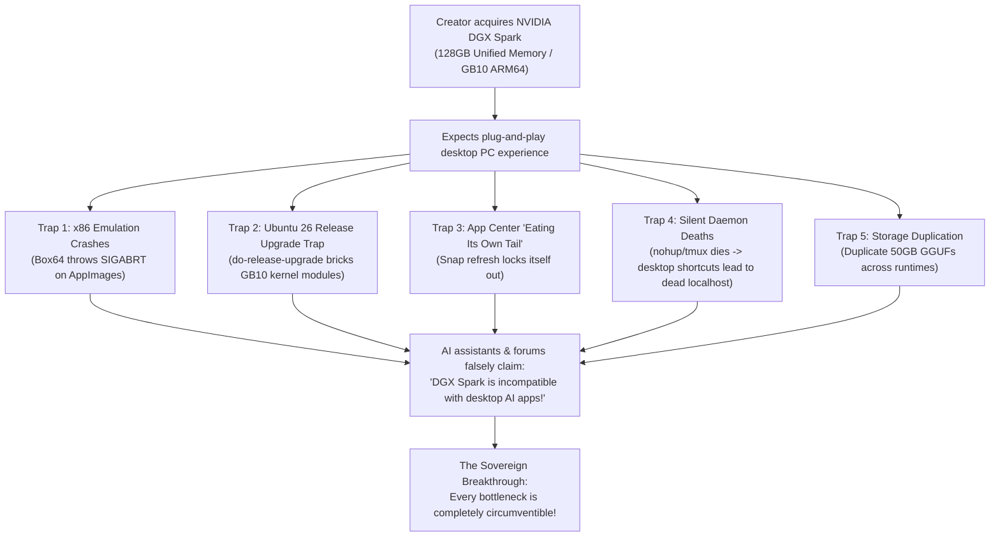
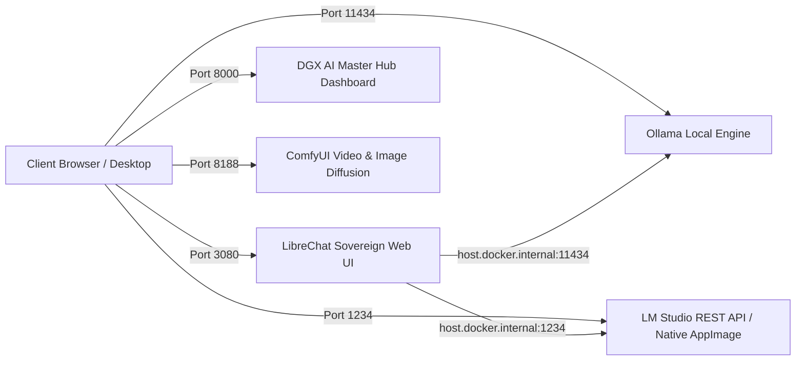

# NVIDIA DGX Spark Agentic Blueprint
## The Sovereign System Administrator Protocol & Field Guide for Grace Blackwell GB10

> **Empowering Creators, Researchers & Engineers to Circumvent the "ARM64 Blackwell Wall"**  
> *A 100% Free, Open-Source, Agent-Agnostic Architecture for Managing, Hardening, and Running SOTA AI on the NVIDIA DGX Spark.*

---

## 1. The Origin Story: The Creator Bottleneck Trap

Across the global AI creator community, early adopters invested in the **NVIDIA DGX Spark** (Grace Blackwell GB10, 128GB Unified Memory, ARM64) anticipating a personal supercomputer. Instead, many creators hit an unexpected wall of friction, confusion, and broken software:



### The 5 Classic Traps & Misconceptions:
1. **The "ARM64 / x86 Translation Trap":**  
   Creators attempted to run standard Linux AppImages (e.g. LM Studio, custom Electron apps). When run via translation layers (`box64`), they instantly threw `SIGABRT` due to unsupported syscalls and missing x86 libraries. Flawed AI assistants and online threads declared: *"LM Studio has no GUI on ARM64 and is incompatible with DGX Spark."* **This was completely false.** LM Studio maintains official native ARM64 Linux builds.
2. **The "Ubuntu 26 Release Upgrade Trap":**  
   Ubuntu's default `Prompt=lts` prompted users to upgrade to Ubuntu 26 (`resolute`). When triggered, the distribution upgrade severed NVIDIA's proprietary Grace Blackwell GB10 kernel modules and CUDA 13 drivers, risking an unbootable or headless state.
3. **The "Ouroboros / Eating Your Own Tail Trap":**  
   The Ubuntu App Center (`snap-store`) showed updates for itself in its own GUI. Clicking "Update" caused `snapd` to hang or error out because the app cannot modify its own open files while actively executing.
4. **The "VRAM Ceiling vs. Unified Memory Misconception":**  
   Creators treated the DGX Spark like an overpriced consumer graphics card (RTX 4090/5090). In reality, consumer GPUs are hard-capped by **16GB–24GB VRAM**, making 70B+ LLM inference, 128k context windows, and full-scale LoRA fine-tuning impossible. The DGX Spark’s **128GB coherent memory pool** eliminates PCIe transfer bottlenecks entirely.
5. **The "Silent Daemon Death & Broken Shortcuts Trap":**  
   Ad-hoc scripts ran background AI servers using `nohup` or `&`. Upon reboot or terminal exit, processes died silently, leaving desktop shortcuts pointing to dead ports and greeting users with browser connection errors.

---

## 2. The Philosophy: Why a Master Prompt Beats a Heavy App

Rather than constructing a brittle, bloated software wrapper that requires constant patching as upstream dependencies change, this project takes a **sovereign, agentic approach**:

1. **Agent-Agnostic Design:**  
   Whether you use **Google Antigravity**, **OpenAI Codex**, **OpenClaw**, **Claude Code**, or a local CLI coding agent, you can feed it the [`MASTER_SYSADMIN_PROMPT.md`](./MASTER_SYSADMIN_PROMPT.md).
2. **Instant System Administrator:**  
   The prompt instantly equips the agentic AI with the 7 Core Invariants of the DGX Spark architecture, turning it into a battle-tested system administrator that understands ARM64, GB10 CUDA 13, systemd user daemons, and zero-duplication storage.
3. **Transparent & Reproducible:**  
   Every action is an atomic, verified shell command or configuration change that you can inspect, audit, and understand.

---

## 3. The DGX Spark Architectural Invariants

| Invariant | Problem Solved | Correct Sovereign Practice |
| :--- | :--- | :--- |
| **1. ARM64 Native Primacy** | Avoids `SIGABRT` crashes from `box64` emulation. | Always deploy native `aarch64` binaries (e.g. native LM Studio ARM64 AppImage & `llmster`). |
| **2. OS Distribution Lock** | Prevents breaking GB10 kernel modules via `do-release-upgrade`. | Set `Prompt=never` in `/etc/update-manager/release-upgrades`. Pin to Ubuntu 24.04 LTS (Noble). |
| **3. Persistent Systemd Daemons** | Eliminates dead localhost ports from killed `nohup` jobs. | All services run under `~/.config/systemd/user/` with `loginctl enable-linger $USER` active. |
| **4. Zero-Duplication Models** | Prevents filling the 3.6TB NVMe with duplicate 50GB checkpoints. | Store master GGUFs in `~/ai-workspace/models/` and symlink via `lms import -l` or point Modelfiles. |
| **5. Container-Host Bridge** | Resolves Docker UIs failing to reach host LLM endpoints. | Bind host AI daemons to `0.0.0.0` or configure `host.docker.internal:host-gateway`. |
| **6. Plain-Text Accessibility** | Prevents users with ADHD or busy workflows from getting locked out. | Place permanent credential files (e.g. `LIBRECHAT_LOGIN.txt`) directly on `~/Desktop/`. |

---

## 4. Quick Start: How to Use This Blueprint

### Step 1: Clone This Repository
```bash
git clone https://github.com/YourUsername/dgx-spark-agentic-blueprint.git ~/ai-workspace/apps/dgx-spark-agentic-blueprint
cd ~/ai-workspace/apps/dgx-spark-agentic-blueprint
```

### Step 2: Feed the Master Prompt to Your AI Agent
Open your agentic assistant (**Google Antigravity**, **Claude Code**, **OpenClaw**, or **Codex**) and paste the complete contents of:
👉 [`MASTER_SYSADMIN_PROMPT.md`](./MASTER_SYSADMIN_PROMPT.md)

### Step 3: Run Modular Sub-Commands
You can now command your AI agent using intuitive sub-commands:

* **`/audit`** — Runs a comprehensive telemetry check across the GB10 GPU, 128GB unified memory pool, active listening ports, and enabled systemd user services.
* **`/lock-os`** — Permanently locks Ubuntu against accidental distribution upgrades (`resolute` / Ubuntu 26) to preserve NVIDIA Blackwell drivers.
* **`/install-lmstudio-gui`** — Downloads and configures the official native ARM64 LM Studio AppImage on the desktop.
* **`/enable-llmster`** — Configures the headless `llmster` engine as an enabled systemd user service listening on `0.0.0.0:1234`.
* **`/symlink-models`** — Scans existing GGUF models and links them into LM Studio with zero disk duplication.
* **`/deploy-librechat`** — Deploys the sovereign LibreChat multi-model chat UI with persistent 10-year login sessions and auto-generated desktop login cheat sheets.

---

## 5. Verified Port Architecture on DGX Spark



| Service | Port | Protocol | Interface Type | Description |
| :--- | :--- | :--- | :--- | :--- |
| **LM Studio (llmster)** | `1234` | HTTP / REST | OpenAI-Compatible API | Headless native ARM64 inference engine on GB10 GPU |
| **LM Studio GUI** | Desktop | AppImage | Native Linux ARM64 Window | Official visual model explorer and chat GUI |
| **LibreChat** | `3080` | HTTP / Web | Web Application (Docker) | Sovereign multi-model chat interface with saved history |
| **Ollama** | `11434` | HTTP / REST | Local Engine | Multi-model background LLM runner |
| **DGX AI Master Hub** | `8000` | HTTP / Web | Dashboard | 1-Click launcher for all local AI endpoints |
| **ComfyUI** | `8188` | HTTP / Web | Node-Based WebUI | Local image & video diffusion (Wan 2.1 / FLUX.1) |

---

## 6. Enterprise Serving & Training (NIM & NeMo)

For creators scaling into enterprise inference and training:
1. **NVIDIA NIM (`build.nvidia.com/spark/nim-llm`):**
   Dedicated DGX Spark container images (`nvcr.io/nim/...-dgx-spark`) with automated TensorRT engine compilation and model caching in `~/.cache/nim`.
2. **NeMo AutoModel (`build.nvidia.com/spark/nemo-fine-tune`):**
   Full PEFT, LoRA, and SFT fine-tuning in native PyTorch with Blackwell FP8 precision.
3. **Unsloth on DGX Spark (`build.nvidia.com/spark/unsloth`):**
   2×–5× faster LoRA training using custom Triton kernels with direct export to GGUF.

---

## 7. License & Credits

* **Standard Origin & Architectural Design:** Ajarn Spencer Littlewood ([www.ajarnspencer.com](https://www.ajarnspencer.com) | [GitHub](https://www.github.com/AjarnSpencer))
* **License:** MIT License. Free for all creators, researchers, and developers.
* **Hardware Support:** Dedicated to the NVIDIA DGX Spark community.
